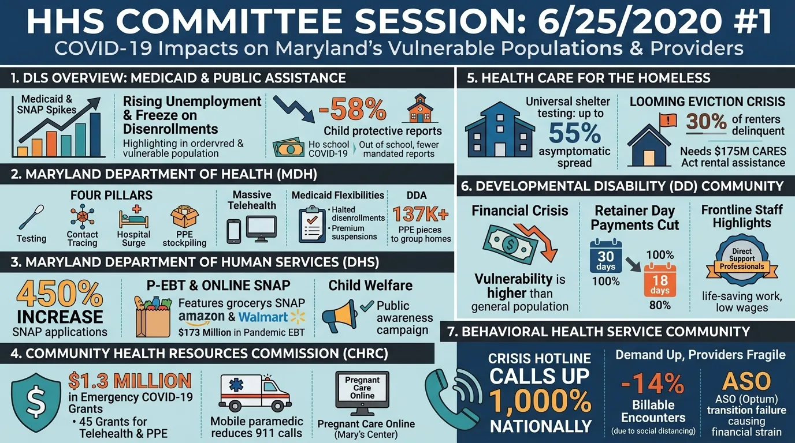

<div class="ytd-hero" markdown>

<div markdown>

<span class="ytd-eyebrow">Open source &middot; MIT &middot; Runs on your cloud</span>

<h1>Hours of video.<br><span class="ytd-gradient-text">Minutes to read.</span></h1>

<p class="ytd-sub">youtube-to-docs turns any YouTube video, playlist or channel into searchable transcripts, Q&amp;A that names who asked and who answered, summaries, infographics, audio briefings and WCAG 2.1 AA captions. One command, on the AI provider you already use.</p>

<div class="ytd-cta" markdown>
[Get started](#get-started){ .md-button .md-button--primary }
[Watch the demo :material-play-circle:](https://www.youtube.com/watch?v=H6Jw10bmMcI){ .md-button }
</div>

<div class="ytd-install"><span>$</span> uvx youtube-to-docs --help</div>

<p class="ytd-trust">Works with <strong>Gemini</strong>, <strong>Vertex AI</strong>, <strong>AWS Bedrock</strong> and <strong>Azure Foundry</strong>. Saves to <strong>CSV</strong>, <strong>Google Drive</strong>, <strong>SharePoint</strong> or <strong>Hugging Face</strong>.</p>

</div>

<div class="ytd-hero-art">

</div>

</div>

<div class="ytd-stats">
  <div class="ytd-stat"><b>1</b><span>command, from URL to a full document set</span></div>
  <div class="ytd-stat"><b>16</b><span>artifact types per video, indexed in one CSV</span></div>
  <div class="ytd-stat"><b>4</b><span>AI platforms: Gemini, Vertex AI, Bedrock, Foundry</span></div>
  <div class="ytd-stat"><b>~2&cent;</b><span>to summarize a long meeting with Flash-Lite (<a href="performance/">benchmark</a>)</span></div>
</div>

<div class="ytd-section" markdown>

<span class="ytd-eyebrow">What you get</span>

## Everything said, everything shown. Organized.

<p class="ytd-lede">A transcript is only the start. Each video becomes a set of documents you can search, share, publish and listen to. Every file is listed in a CSV that opens in Excel or Google Sheets.</p>

<div class="ytd-grid" markdown>

<div class="ytd-card" markdown>
<span class="ytd-icon">:material-text-box-search:</span>
### Transcripts and SRT
YouTube's captions, or a fresh speech-to-text pass with word timings and speaker labels from Gemini, Google Cloud or AWS.
</div>

<div class="ytd-card" markdown>
<span class="ytd-icon">:material-forum:</span>
### Q&A that names people
Every question, who asked it, who answered, and a link that jumps to the exact second in the video.
</div>

<div class="ytd-card" markdown>
<span class="ytd-icon">:material-format-list-text:</span>
### Summaries and tags
A full summary, a one-sentence summary and topic tags. Write them from the transcript, or have Gemini watch the video itself.
</div>

<div class="ytd-card" markdown>
<span class="ytd-icon">:material-image-text:</span>
### Infographics with alt text
A one-page visual of the session, with descriptive alt text written by a model that looks at the image.
</div>

<div class="ytd-card" markdown>
<span class="ytd-icon">:material-headphones:</span>
### Audio and video briefings
The summary read aloud by a natural voice, and combined with the infographic into a short video you can share.
</div>

<div class="ytd-card" markdown>
<span class="ytd-icon">:material-translate:</span>
### Any language
Transcripts, captions, summaries, Q&A, audio and video in a second language, translated by an LLM, AWS Translate or Google Cloud Translation.
</div>

</div>

</div>

<div class="ytd-section" markdown>

<span class="ytd-eyebrow">Accessibility, built in</span>

## Auto-captions aren't compliant. These are.

<p class="ytd-lede">One flag, <code>-cc</code>, makes a video accessible under WCAG 2.1 Level AA and <a href="https://www.section508.gov/create/captions-transcripts/">Section 508</a>. It produces the files that public bodies, universities and publishers need, instead of the raw output of speech recognition.</p>

<div class="ytd-grid ytd-grid--2" markdown>

<div class="ytd-card" markdown>
<span class="ytd-icon">:material-closed-caption:</span>
### Corrected captions
Timing is checked word by word against a second transcript. Misheard words, names, punctuation and missed speech are fixed. Every speaker is named on each change, using the name plates shown on screen. Lines are laid out at two 42-character lines over 1–7 seconds.
</div>

<div class="ytd-card" markdown>
<span class="ytd-icon">:material-eye-outline:</span>
### Audio description
Slides, chart figures, on-screen text and votes are described for blind viewers and fitted into pauses in the speech. You get WebVTT description tracks, a descriptive transcript and a video with the descriptions narrated.
</div>

</div>

</div>

<div class="ytd-section" markdown>

<span class="ytd-eyebrow">Real output</span>

## A four-hour public hearing, made readable

<p class="ytd-lede">These outputs come from a single run on a Maryland Senate Health and Human Services subcommittee session about COVID-19's impact on vulnerable populations. They are shown exactly as generated, without edits.</p>

<div class="ytd-showcase" markdown>

<figure markdown>

<figcaption>Infographic generated by <code>gemini-nano-banana-2.1</code> from a <code>gemini-4-argon</code> summary. Image models can still misspell small text.</figcaption>
</figure>

<div markdown>

<ul class="ytd-checklist">
<li>Speakers identified with their titles, such as <em>Robert Neall (Secretary, Maryland Department of Health)</em></li>
<li>24 questions paired with their answers and timestamp links</li>
<li>Summary organized by agency and by testimony</li>
<li>Alt text describing all seven panels of the infographic</li>
<li>Audio summary, tags and a one-line summary for the catalog</li>
</ul>

??? example "Excerpt from the Q&A table"

    | Questioner | Question | Responder | Time |
    | --- | --- | --- | --- |
    | Jim Rosapepe (Senator) | Is it freezing us from dropping people from Medicaid or freezing us from adding people? | Simon Powell (Principal Policy Analyst, DLS) | [00:23:31](https://www.youtube.com/watch?v=bnjjmvy1RlU&t=1411) |
    | Jim Rosapepe (Senator) | And the 6% is for what exactly? | Simon Powell (Principal Policy Analyst, DLS) | [00:23:55](https://www.youtube.com/watch?v=bnjjmvy1RlU&t=1435) |
    | Adelaide Eckardt (Senator) | Were you surprised there wasn't more increased enrollment on the Shore? | Simon Powell (Principal Policy Analyst, DLS) | [00:25:56](https://www.youtube.com/watch?v=bnjjmvy1RlU&t=1556) |

</div>

</div>

</div>

<div class="ytd-section" markdown>

<span class="ytd-eyebrow">How it works</span>

## From link to library in four steps

<div class="ytd-steps" markdown>

<div class="ytd-step" markdown>
### Point it at YouTube
Use a video URL, a video ID, a playlist or a whole <code>@channel</code>. Batches are handled for you.
</div>

<div class="ytd-step" markdown>
### Get the words
Use YouTube's captions, or transcribe the audio again for real word timings and speaker labels.
</div>

<div class="ytd-step" markdown>
### Let the model read
Your chosen LLM extracts speakers, Q&A, summaries and tags. Gemini can also watch the video for on-screen context.
</div>

<div class="ytd-step" markdown>
### Publish anywhere
Save files locally, or to Google Drive, SharePoint or a Hugging Face dataset. The cost of each video is tracked in the CSV.
</div>

</div>

[Read the full architecture :material-arrow-right:](how-this-works.md)

</div>

<div class="ytd-section" markdown>

<span class="ytd-eyebrow">Who it's for</span>

## Built for teams with more video than time

<div class="ytd-grid ytd-grid--2" markdown>

<div class="ytd-card" markdown>
<span class="ytd-icon">:material-bank:</span>
### Governments and legislatures
Make hearings, council meetings and briefings searchable and accessible. Process an entire channel archive, not just the next meeting.
</div>

<div class="ytd-card" markdown>
<span class="ytd-icon">:material-newspaper-variant:</span>
### Communications and media teams
Turn every webinar, keynote and interview into ready-to-publish summaries, social-ready infographics and audio briefings.
</div>

<div class="ytd-card" markdown>
<span class="ytd-icon">:material-microscope:</span>
### Researchers and analysts
Build a structured corpus from hundreds of videos. Compare models side by side, count terms and load everything into a dataframe.
</div>

<div class="ytd-card" markdown>
<span class="ytd-icon">:material-robot:</span>
### AI agents and builders
Install it as a Claude Code or Antigravity plugin, call it over MCP, run the web app or import it as a Python library.
</div>

</div>

</div>

<div class="ytd-section ytd-compare" markdown>

<span class="ytd-eyebrow">Why not just download the transcript?</span>

## A transcript is raw material. This is the finished document.

| | Transcript downloaders | youtube-to-docs |
| --- | :---: | :---: |
| Transcript and SRT | :material-check: | :material-check: |
| Q&A with speakers and timestamp links | :material-close: | :material-check: |
| Summaries, tags, infographics, audio | :material-close: | :material-check: |
| WCAG 2.1 AA captions and audio description | :material-close: | :material-check: |
| Whole playlists and channels | Sometimes | :material-check: |
| Choice of AI provider | :material-close: | Gemini, Vertex AI, Bedrock, Foundry |
| Cost per video recorded | :material-close: | :material-check: |
| Output to Sheets, Excel, Drive, SharePoint | :material-close: | :material-check: |

</div>

<div class="ytd-section ytd-quickstart" markdown>

<span class="ytd-eyebrow">Get started</span>

## Up and running in one line { #get-started }

<p class="ytd-lede">No clone, no virtualenv. If you have <a href="https://docs.astral.sh/uv/">uv</a>, you can run it now. Pick the way you work:</p>

=== "Command line"

    ```bash
    # Everything, best quality: summaries, Q&A, infographic, audio and accessible captions
    uvx --with "youtube-to-docs[all]" youtube-to-docs https://www.youtube.com/watch?v=B0x2I_doX9o -a gemini-pro -cc

    # A whole channel, summaries only
    uvx youtube-to-docs @mga-hgo1740 -m gemini-3.5-flash-lite
    ```

    Set `YOUTUBE_DATA_API_KEY` and `GEMINI_API_KEY` first (see [Setup](usage.md#setup)). Artifacts land in `youtube-to-docs-artifacts/`, and every option is in the [Usage guide](usage.md).

=== "Claude Code"

    ```bash
    claude plugin marketplace add DoIT-Artificial-Intelligence/youtube-to-docs
    claude plugin install youtube-to-docs@youtube-to-docs
    ```

    Then ask: *"Make the best accessible captions for https://www.youtube.com/watch?v=B0x2I_doX9o"*, or run `/youtube-to-docs <url>`.

=== "Antigravity"

    ```bash
    agy plugin install https://github.com/DoIT-Artificial-Intelligence/youtube-to-docs
    ```

    Then ask for what you want in plain language, e.g. *"Save a summary of this video in Spanish"*.

=== "Web app"

    ```bash
    uvx --with "youtube-to-docs[all]" youtube-to-docs-app
    ```

    Open <http://localhost:8000>, paste a link and watch progress live. See the [Web App docs](usage.md#web-app).

=== "Python"

    ```python
    from youtube_to_docs.transcript import fetch_transcript

    transcript, is_generated = fetch_transcript("atmGAHYpf_c")
    ```

??? info "Optional extras and installing uv"

    Keep installs light by adding only what you need with `--with "youtube-to-docs[extra,...]"`:

    `audio` (download audio and video with yt-dlp) &middot; `video` (build MP4s with ffmpeg) &middot; `workspace` (Google Drive) &middot; `m365` (SharePoint and OneDrive) &middot; `aws` (Bedrock) &middot; `azure` (Azure OpenAI) &middot; `gcp` (Gemini, Vertex AI and Google Cloud speech) &middot; `app` (web app) &middot; `all` (everything)

    Install uv:

    - **macOS/Linux**: `curl -LsSf https://astral.sh/uv/install.sh | sh`
    - **Windows**: `powershell -ExecutionPolicy ByPass -c "irm https://astral.sh/uv/install.ps1 | iex"`

</div>

<div class="ytd-section ytd-final" markdown>

<span class="ytd-eyebrow">Free and open source</span>

## Your video archive, finally readable.

<p>Start with one video. Then point it at the whole channel.</p>

<div class="ytd-cta" markdown>
[Read the usage guide](usage.md){ .md-button .md-button--primary }
[:fontawesome-brands-github: Star on GitHub](https://github.com/DoIT-Artificial-Intelligence/youtube-to-docs){ .md-button }
</div>

</div>

<p class="ytd-trust" style="text-align:center">Created with the help of AI. All artifacts have been checked and work as expected. Model pricing is tracked on the <a href="pricing/">Pricing</a> page.</p>
