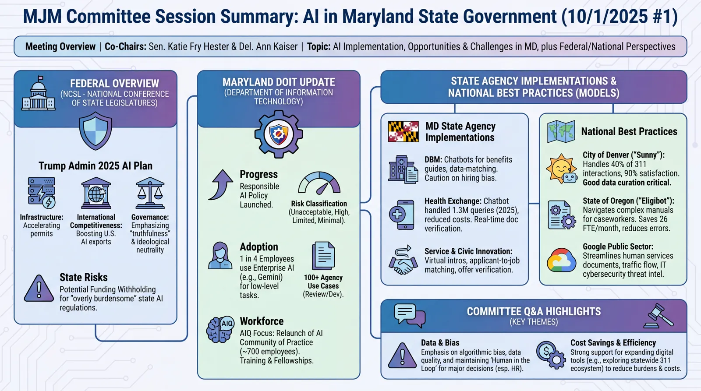
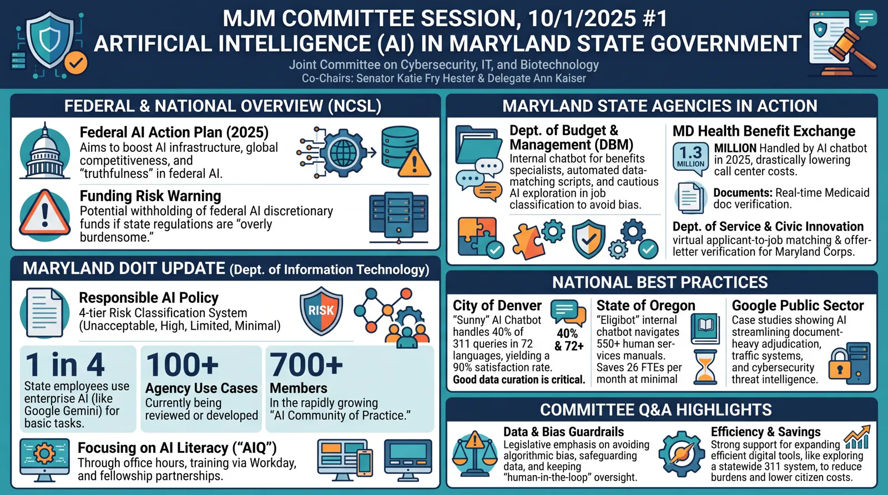
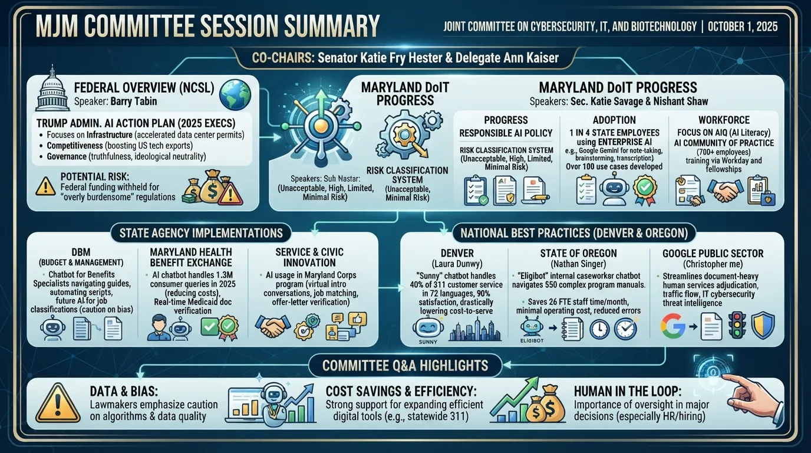
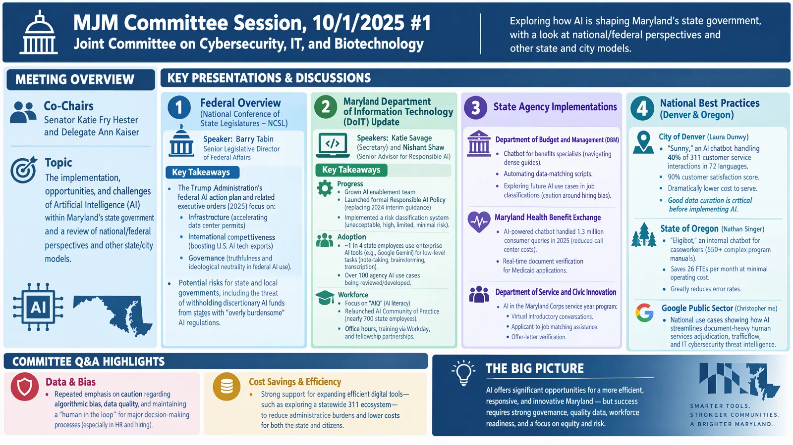
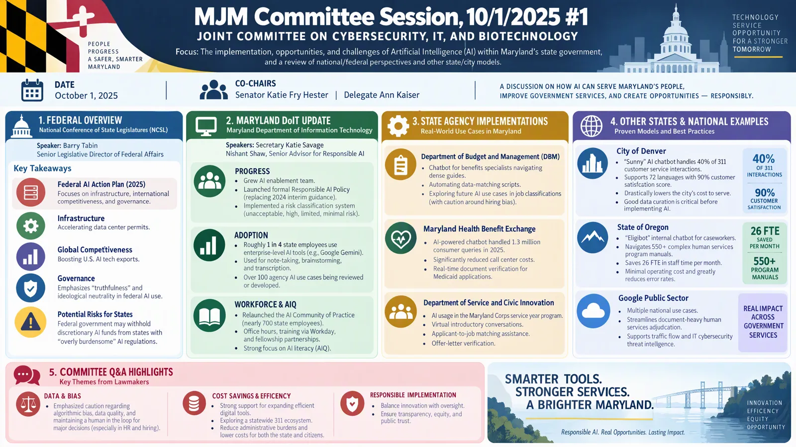

# Performance

## Summaries

How long each model takes to summarize the same transcript, and what it costs. The test uses the YouTube transcript of [atmGAHYpf_c](https://www.youtube.com/watch?v=atmGAHYpf_c), about 38,000 input tokens. Claude models count tokens differently, so they report more input tokens for the same text.

- **Time** is the wall-clock time for one `generate_summary` call. *failed* means the call failed or the provider wasn't configured.
- **Cost** is in USD, from the token counts and the prices on the [Pricing](pricing.md) page.

To re-run it, see [`scripts/performance`](https://github.com/DoIT-Artificial-Intelligence/youtube-to-docs/tree/main/scripts/performance).

--8<-- "docs/assets/time_to_summarize.md"

## Infographics

How long each image model takes to draw an infographic from the same summary, and what it costs. The summary is of the same video, written by `gemini-3.5-flash-lite` (the default `-m` model). Each model runs at its default: 16:9 landscape at the highest resolution it supports, with high thinking for Gemini.

- **Time** is the wall-clock time for one `generate_infographic` call. *failed* means the call failed or the provider wasn't configured.
- **Cost** is in USD, from the token counts and the prices on the [Pricing](pricing.md) page.
- **Size** is the width and height of the image in pixels. `gemini-3.1-flash-lite-image` only supports 1K.

--8<-- "docs/assets/time_to_infographic.md"

`gemini-3-pro-image`, the default for `-i`, was the only model with no text errors on both videos we compared (this one and a 3h49m hearing). Image models can still misspell words, so check the text before you publish an infographic. Select an image to open the preview at full width.

<figure markdown>

<figcaption><code>gemini-3-pro-image</code>: Default for <code>-i</code>. Clear 16:9 layout with no text errors found.</figcaption>
</figure>

<figure markdown>

<figcaption><code>gemini-nano-banana-2.1</code>: Bold, large headline numbers that stay readable as a thumbnail.</figcaption>
</figure>

<figure markdown>

<figcaption><code>gemini-3.1-flash-lite-image</code>: Fastest and cheapest, but 1K only, with some garbled and repeated text.</figcaption>
</figure>

<figure markdown>

<figcaption><code>foundry-gpt-image-2.5-flare</code>: The most detail, including speakers and their roles, in a dense layout.</figcaption>
</figure>

<figure markdown>

<figcaption><code>foundry-gpt-image-2.5-sunburst</code>: The most polished, poster-like design, but with several misspellings.</figcaption>
</figure>

